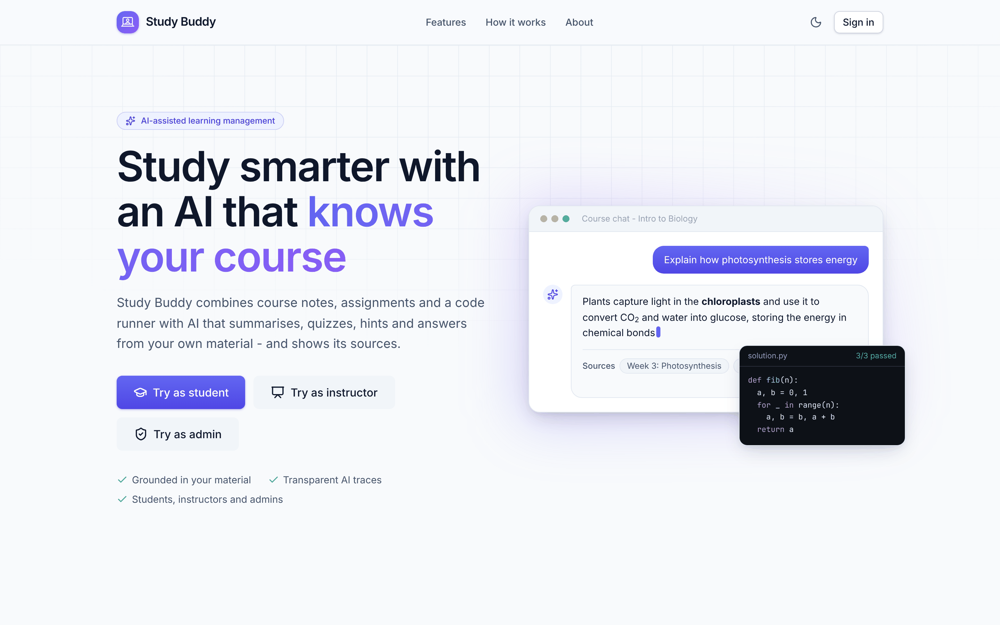
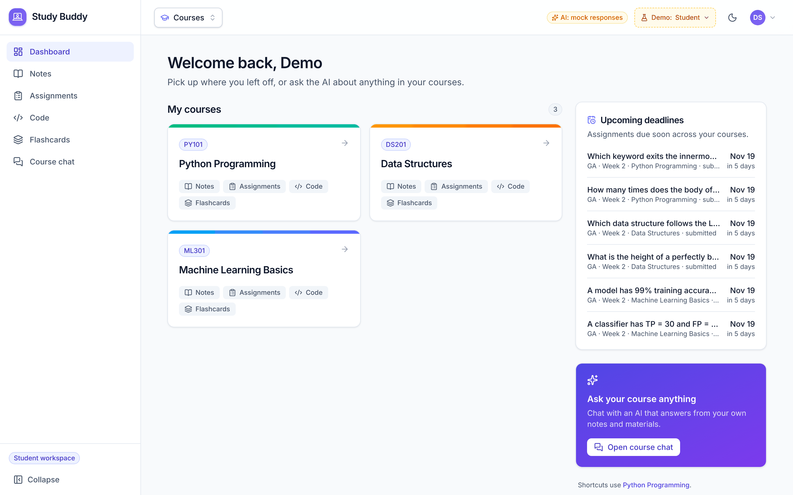
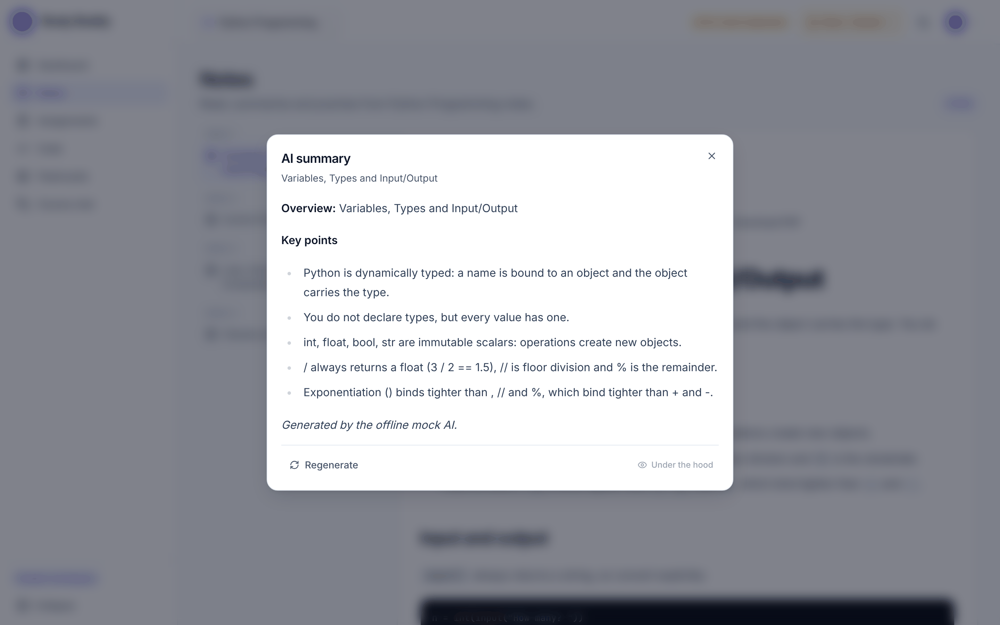
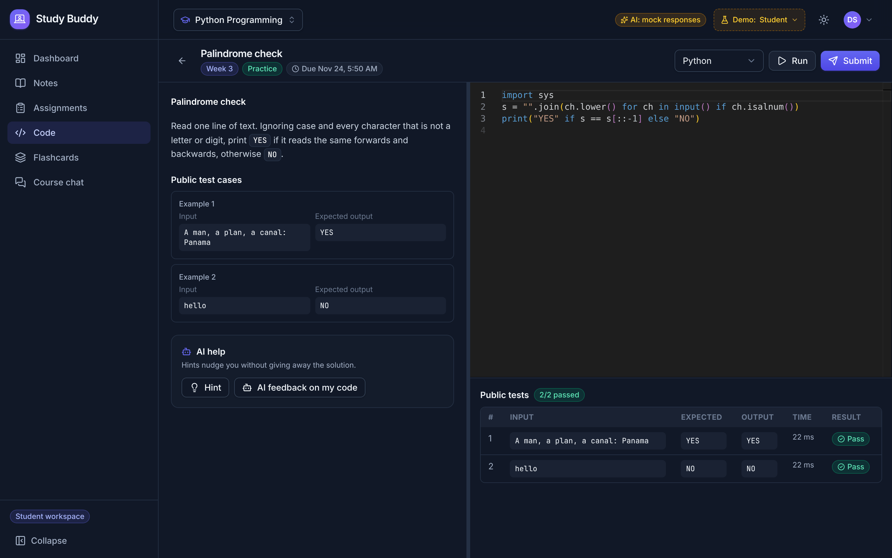
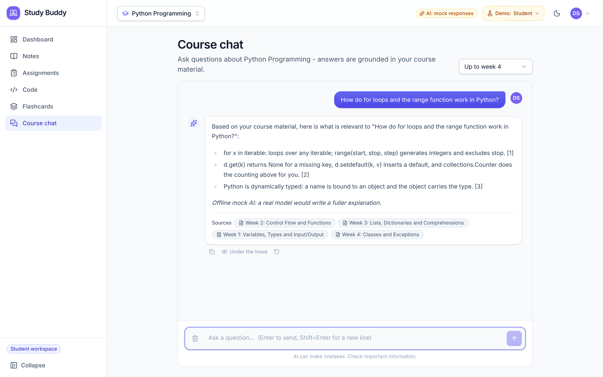
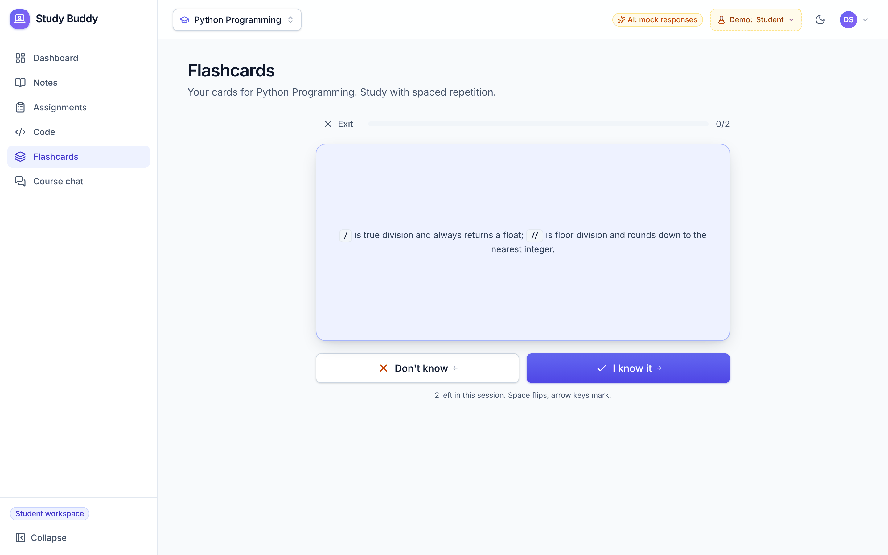
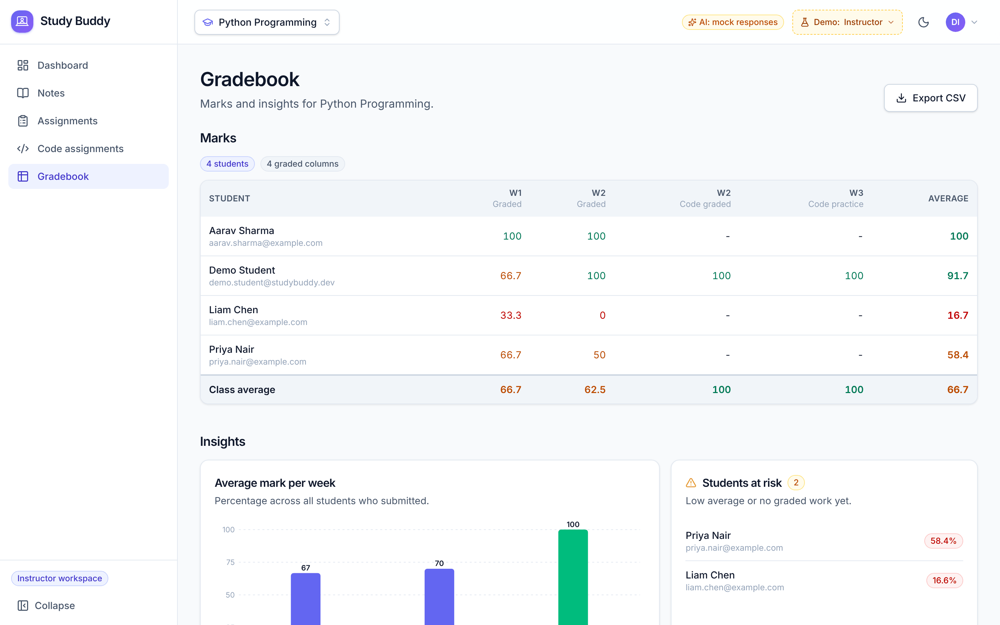
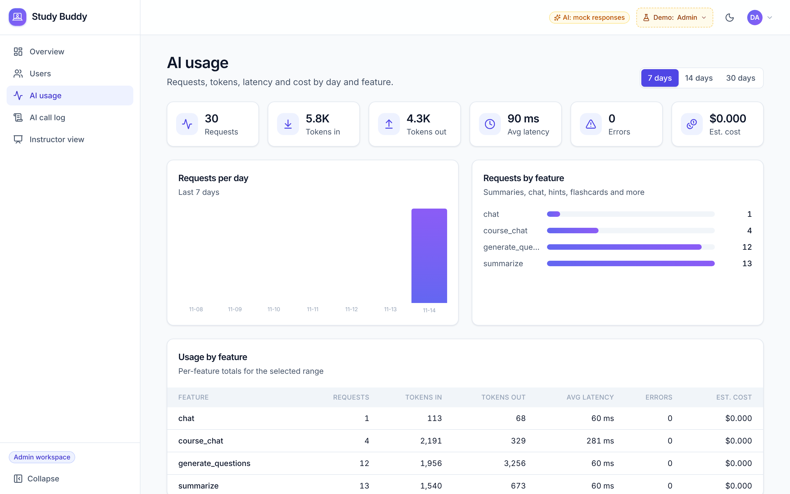

# Study Buddy

[](https://github.com/driptobhattacharyya/StudyBuddy/actions/workflows/ci.yml)

An AI-assisted learning management system: courses, weekly notes, graded assignments with sandboxed coding questions, flashcards, and a course-aware AI tutor that answers from the material.

Live demo: https://studybuddy.driptobhattacharyya.com (served by a Cloudflare Worker; the API origin is https://study-buddy-api-8i28.onrender.com; sign in with one click as a student, instructor or admin). The API is on Render's free plan and sleeps when idle, so the first request can take up to a minute.

## Screenshots

| | |
|---|---|
|  |  |
|  |  |
|  |  |
|  |  |

## Features

### Students
* Browse courses, weekly notes and course material.
* Watch weekly video lectures (YouTube) with lecture notes and links, mark them as watched, and jump from a week's lectures to that week's questions.
* Answer MCQ, MSQ and numeric assignments; answers are graded on submission with per-question marks.
* Solve coding assignments in an in-browser editor (Python, JavaScript, Java) with instructor-provided starter code. **Run** checks your code against the public tests only and saves nothing; **Submit** also runs the hidden tests, then saves and grades the attempt.
* Personal flashcards per course.
* Track marks and per-topic insights.

### Instructors
* Create and update courses, weekly material, notes and assignments, including coding assignments with private test cases.
* Add, edit, reorder and remove video lectures per week by pasting any YouTube link, with a live preview, Markdown notes and resource links.
* Gradebook with all students' marks per course, and class insights (averages per week, students at risk).
* Generate a draft quiz, flashcards and summary from course material with AI, to edit before publishing.

### Admins
* Overview statistics for users, courses, assignments and submissions.
* User management, including changing roles.
* AI usage dashboard (requests, tokens, latency, errors, estimated cost per day and feature) and a log of recent AI calls.
* Demo data reset when demo mode is enabled.

### AI features
* **Chat with course material:** streamed answers grounded in retrieved passages, with citations (note title and week).
* **Summaries and questions:** summaries and MCQs generated from text.
* **Hints and code feedback:** Socratic hints for coding problems, and an AI review of submitted code (correctness, style, complexity). Full solutions are not revealed before the deadline.
* **Under the hood:** every AI answer links to a trace showing the prompt, retrieved passages, model, tokens and latency.
* **Retrieval:** embeddings with cosine similarity when a Gemini key is configured, keyword (BM25) search otherwise.

## Tech stack

* **Backend:** Python 3.12, FastAPI, pydantic, MongoDB (pymongo), PyJWT, httpx, google-genai.
* **Frontend:** React 19, Vite, React Router, Tailwind CSS, Monaco editor, react-markdown.
* **AI:** Google Gemini (default in code), OpenAI (the Render Blueprint's provider; chat and embeddings), OpenRouter, or an offline mock provider (`AI_PROVIDER=mock`) that needs no key.
* **Database:** MongoDB (Atlas in production); the API can run on an in-memory database (`mongomock://`) for demos.
* **Infrastructure:** Docker, docker compose, nginx, Render Blueprint.
* **Testing and CI:** pytest (offline, using mongomock), ESLint, a Playwright end-to-end smoke suite (`Frontend/e2e`, mock AI, covering the three roles), GitHub Actions.

## Architecture

The backend is a set of thin FastAPI routers over shared core modules (config, JWT and roles, rate limits), an AI layer (providers, prompts, RAG, tracing) and a sandboxed code runner. The frontend is a single-page app that talks to the API over REST and WebSocket.

See [docs/ARCHITECTURE.md](docs/ARCHITECTURE.md) for components, request flow, auth and roles, the AI pipeline, the code-runner sandbox and the data model.

## Quick start

### Backend (demo mode, in-memory database)

```bash
cd Backend && python3 -m venv venv && source venv/bin/activate && pip install -r requirements-dev.txt
MONGODB_URI=mongomock:// DEMO_MODE=true SEED_DEMO_ON_STARTUP=true uvicorn main:app --reload
```

API docs: http://localhost:8000/docs. Running Java and JavaScript submissions locally needs `javac` and `node` on the PATH.

### Frontend

```bash
cd Frontend && npm ci
npm run dev
```

Open http://localhost:5173. The app calls the API at `VITE_API_URL` (default `http://localhost:8000`). When `DEMO_MODE=true` the backend offers demo sign-in for the student, instructor and admin roles (`POST /auth/demo`).

### More course content (optional)

The demo seed gives PY101, DS201 and ML301 a set of YouTube lectures. Three further courses can be added on top:
CS01 Python Data Structures and Algorithms, MA01 Linear Algebra, Visually and BIO01 Foundations of Cell Biology. Together they have
38 lectures (MIT OpenCourseWare, 3Blue1Brown, Crash Course), 16 weekly reading notes, 160 questions and 15 auto-graded Python problems.

```bash
cd Backend
python -m scripts.seed_extra_courses --dry-run     # check the data; no database needed
python -m scripts.seed_extra_courses --enrol-demo  # load them and enrol the demo student
```

Re-running is not a no-op: it resets these courses' seeded questions, reading notes and week titles to the shipped text (matched on question text / note title). Deadlines are only set the first time, and lectures are seeded once per course (a `seed_markers` entry), so lecture edits and deletes made in the UI are kept.
Candidate lectures whose video ids have not been checked yet are listed in `UNVERIFIED_LECTURES` (`scripts/seed_content.py`) and
`PENDING_LECTURES` (`scripts/extra_courses/*.py`) and are not loaded by default.

### Docker compose (API, MongoDB and frontend)

```bash
docker compose up --build
```

The frontend is served at http://localhost:8080, the API at http://localhost:8000, and MongoDB runs in its own container with demo mode and seeding enabled. To change settings, copy `Backend/.env.example` to `Backend/.env` before starting.

## Configuration

All backend settings are environment variables (template: [`Backend/.env.example`](Backend/.env.example)). Key settings:

| Variable | Default | Purpose |
|---|---|---|
| `MONGODB_URI` | `mongodb://localhost:27017` | MongoDB connection; `mongomock://` for an in-memory database |
| `DB_NAME` | `study_buddy` | Database name |
| `SECRET_KEY` | generated at start-up | JWT signing key. Set it in any real deployment |
| `GOOGLE_CLIENT_ID`, `GOOGLE_CLIENT_SECRET` | empty | Enables Google sign-in |
| `GOOGLE_REDIRECT_URI` | `http://localhost:8000/oauth/callback` | OAuth callback registered with Google |
| `FRONTEND_URL` | `http://localhost:5173` | Where the backend redirects after sign-in (production: `https://studybuddy.driptobhattacharyya.com`) |
| `CORS_ORIGINS` | localhost dev origins | Comma-separated browser origins allowed by CORS (production: `https://studybuddy.driptobhattacharyya.com`) |
| `INSTRUCTOR_EMAILS`, `ADMIN_EMAILS` | empty | Comma-separated emails that receive those roles on sign-in |
| `DEMO_MODE` | `false` | Enables one-click demo logins (`POST /auth/demo`) |
| `SEED_DEMO_ON_STARTUP` | `false` | Seeds the demo dataset on start-up (idempotent) |
| `AI_PROVIDER` | `gemini` | `gemini`, `openai`, `openrouter` or `mock`. `mock` returns deterministic, context-aware canned answers with no network access; it is used automatically when `DEMO_MODE=true` and no API key is set (the UI then shows an "AI: mock responses" badge) |
| `OPENAI_API_KEY`, `OPENAI_MODEL` | empty, `gpt-4o-mini` | OpenAI access (backend only: the key is never sent to the browser or written to logs/traces); `OPENAI_BASE_URL` and `OPENAI_EMBEDDING_MODEL` (`text-embedding-3-small`, used for retrieval) are also configurable |
| `GEMINI_API_KEY`, `GEMINI_MODEL` | empty, `gemini-2.5-flash` | Gemini access; the key also enables embeddings for retrieval |
| `OPENROUTER_API_KEY`, `OPENROUTER_MODEL` | empty, a free Llama model | OpenRouter access |
| `AI_DAILY_REQUEST_CAP` | `500` | Global limit on AI calls per UTC day |
| `RATE_LIMIT_AI_PER_MINUTE` | `20` | Per-user limit on AI calls |
| `CODE_RUNNER` | `local` | `local` (hardened subprocess) or `judge0` |
| `CODE_TIMEOUT_SECONDS`, `CODE_MEMORY_MB` | `5`, `512` | Per-run limits for the local runner |
| `JUDGE0_URL`, `JUDGE0_API_KEY` | empty | Judge0 endpoint when `CODE_RUNNER=judge0` |
| `VITE_API_URL` (frontend) | `http://localhost:8000` | Backend base URL, fixed at build time |

## Testing

```bash
cd Backend && pip install -r requirements-dev.txt && pytest -q
cd Frontend && npm run lint && npm run build

# end-to-end smoke tests (Playwright), against a running backend and a built frontend
cd Backend && MONGODB_URI=mongomock:// DEMO_MODE=true SEED_DEMO_ON_STARTUP=true AI_PROVIDER=mock uvicorn main:app --port 8000 &
cd Frontend && npm run build && npx playwright install chromium && npm run e2e
```

The backend suite runs offline: it uses mongomock, a fake AI provider and mocked HTTP transports. The runner tests need `node` and `javac` on the PATH. CI runs the backend tests, the frontend lint and build, and the end-to-end suite on every push and pull request ([.github/workflows/ci.yml](.github/workflows/ci.yml)).

## Deployment

The API deploys to Render as a Docker web service from [`render.yaml`](render.yaml). The frontend is served by a Cloudflare Worker ([`deploy/cloudflare/`](deploy/cloudflare)), which also proxies `/api/*` to the Render API. The full step-by-step guide, including the manual route, the environment variable table, Atlas, real AI, Google sign-in and hardening, is in [docs/DEPLOYMENT.md](docs/DEPLOYMENT.md).

## Project structure

```
.
├── Backend/                 FastAPI app
│   ├── ai/                  providers, prompts, structured output, RAG, tracing
│   ├── core/                settings, JWT and roles, rate limits, logging
│   ├── database/            lazy MongoDB client
│   ├── models/              request models
│   ├── routes/              API routers (REST and WebSocket)
│   ├── runner/              sandboxed code execution (local, Judge0)
│   ├── scripts/             demo seed, content seed, RAG ingestion
│   ├── tests/               pytest suite
│   ├── utils/               projections, grading, lookups
│   ├── Dockerfile
│   └── main.py              application entry point
├── Frontend/                React + Vite SPA
│   ├── src/                 pages, components, context, lib
│   ├── Dockerfile           build, then serve with nginx
│   └── nginx.conf           SPA fallback and cache headers
├── docs/
│   ├── ARCHITECTURE.md
│   └── screenshots/
├── .github/workflows/ci.yml
├── docker-compose.yml
└── render.yaml
```

## Security notes

* **Role enforcement on the server.** Roles are checked on every request; the frontend's role-based routing is a convenience, not a security boundary. Students never receive answers or hidden test cases.
* **Authentication.** Bearer JWTs (HS256), no cookies, so CORS credentials are disabled. Google sign-in uses the authorization-code flow with a state check and a verified ID token.
* **Demo mode is for demonstrations.** `DEMO_MODE` exposes one-click logins. Keep it off for real users.
* **Code execution is not a sandbox in the strict sense.** The local runner applies a temporary directory, a stripped environment, resource limits, a timeout and output caps, but it is a subprocess on the host, not a virtual machine. For untrusted public use, run the API in the provided non-root container with low `CODE_MAX_CONCURRENCY`, or use `CODE_RUNNER=judge0`.
* **Rate limits are per process.** The sliding-window limiters are in memory, so with several workers or instances each keeps its own counters. The global `AI_DAILY_REQUEST_CAP` is counted from the database and applies across processes.
* **Ephemeral keys.** If `SECRET_KEY` is unset, a random key is generated at start-up; tokens then become invalid after a restart.
* **Errors.** Responses carry a `detail` message and proper status codes; stack traces are not returned.

## History and credits

Study Buddy began as an IIT Madras BS Software Engineering team project (Team 22, 2024) by Pranjal Choudhury, Sagnik De, Pravin S, Mehak Singal, Madhurima Ghosh, Vibhor Jain and Dripto Bhattacharyya. The original repository is at https://github.com/De-Sagnik/soft-engg-project-may-2024-se-may-22.

The project was later rebuilt and extended by Dripto Bhattacharyya: a new backend with role-based access, graded submissions, a sandboxed code runner, the AI layer with retrieval and tracing, the admin dashboard, and the redesigned frontend.

## License

The backend is licensed under the GNU General Public License v3.0; see [Backend/LICENSE](Backend/LICENSE). No separate license file is included for the frontend.
