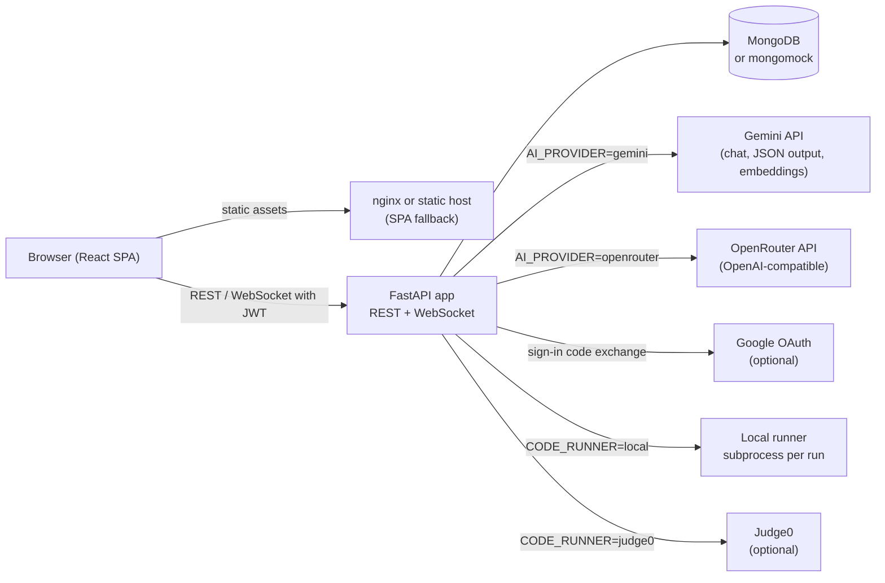
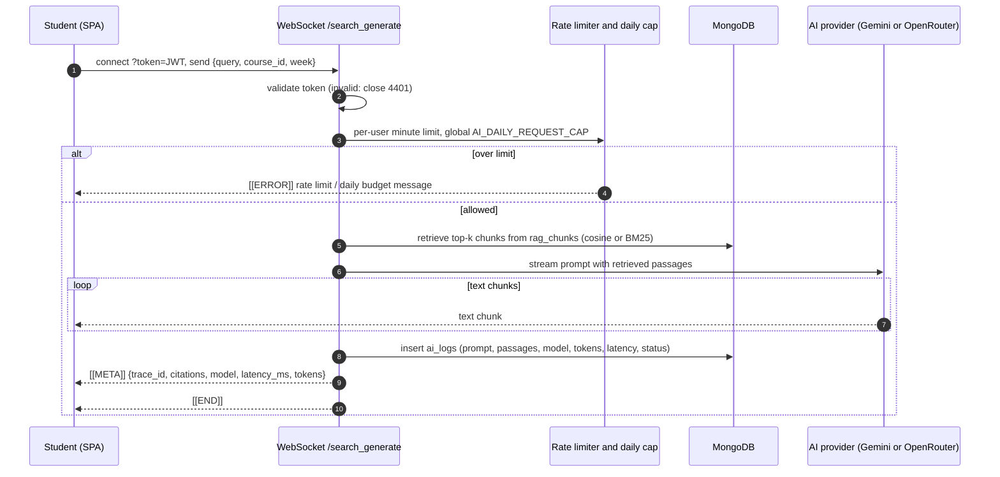

# Architecture

Study Buddy is a two-part application: a FastAPI backend (`Backend/`) backed by MongoDB, and a React single-page app (`Frontend/`) built with Vite. This document describes what the code does today.

## Components

| Component | Location | Responsibility |
|---|---|---|
| API | `Backend/main.py` | App factory, CORS, access log, error handlers, lifespan (indexes, optional demo seed), router registration |
| Config | `Backend/core/config.py` | Settings from environment variables / `.env` (pydantic-settings) |
| Auth and roles | `Backend/core/security.py`, `core/deps.py`, `routes/auth.py` | JWT issuance and validation, role resolution, Google OAuth, demo logins |
| Rate limits | `Backend/core/ratelimit.py` | Per-process sliding-window limiters (AI, code run, auth) |
| Routes | `Backend/routes/` | Thin routers: auth, course, course material, notes, assignment, coding assignment, flashcard, user, AI (REST and WebSocket), admin |
| Models and utils | `Backend/models/`, `Backend/utils/` | Request models, response projections (answers and hidden tests stripped for students), grading, lookups |
| Database | `Backend/database/db.py` | Lazy MongoDB client; `mongomock://` URIs use an in-memory database |
| AI layer | `Backend/ai/` | Providers, prompts, structured output, RAG, tracing |
| Code runner | `Backend/runner/` | Sandboxed execution of Python, JavaScript and Java submissions (`local` or `judge0`) |
| Scripts | `Backend/scripts/` | `seed_demo.py` (idempotent demo data), `seed_content.py`, `ingest.py` (re-index material for RAG) |
| Frontend | `Frontend/src/` | React 19 SPA: landing page, student / instructor / admin shells, AI chat and drawers, code editor |

## System overview

The frontend is configured at build time with `VITE_API_URL`; REST calls and the WebSocket URL (derived from it, `http` to `ws`) both go to the API.

## Request flow

1. The SPA calls the API with `Authorization: Bearer <jwt>` for REST routes. Streaming AI chat uses a WebSocket with the token in the query string (`?token=<jwt>`); an invalid token closes the socket with code 4401.
2. CORS allows only the origins in `CORS_ORIGINS`. Credentials are not used: auth is bearer-token only.
3. Sync handlers run in FastAPI's threadpool. Each request is logged by the access-log middleware (method, path, status, duration).
4. Errors are returned as `{"detail": "..."}` with the appropriate status code. Unhandled exceptions return a generic 500 without a stack trace.

## Auth and roles

* **Roles:** `student` < `instructor` < `admin`. Admins can do everything instructors can, plus `/admin/*`.
* **Role resolution:** the role is derived from `INSTRUCTOR_EMAILS` / `ADMIN_EMAILS` or from the stored user record, and is re-resolved on each request rather than trusted from the token alone. Everyone else is a student.
* **JWT:** HS256, signed with `SECRET_KEY`, lifetime `ACCESS_TOKEN_EXPIRE_MINUTES`. Claims include the subject (email), role, scopes and expiry. If `SECRET_KEY` is unset, an ephemeral key is generated at start-up, so tokens do not survive a restart.
* **Google sign-in:** authorization-code flow with a `state` cookie check, server-side code exchange, and verification of the returned ID token. Only verified Google email addresses are accepted. The backend redirects to `${FRONTEND_URL}/auth/callback#token=<jwt>`; the token is in the URL fragment and the SPA removes it after storing it.
* **Demo mode:** when `DEMO_MODE=true`, `POST /auth/demo` issues tokens for seeded demo users of each role, rate limited per client IP.
* **Field-level protection:** student-facing assignment responses never include `answers` or `private_testcase`. Marks and flashcards are scoped to their owner. Instructor-only endpoints return 403 to students.

## AI layer

**Providers.** `AI_PROVIDER` selects `gemini` (the `google-genai` SDK, `GEMINI_MODEL`) or `openrouter` (an OpenAI-compatible HTTP API via `httpx`, `OPENROUTER_MODEL`). Both implement the same generate and stream interface.

**Structured output.** JSON responses (summaries, generated questions, the assignment generator) are parsed and validated against pydantic models. On a validation failure the call is retried once with the error included in the prompt.

**RAG pipeline.** Course material and notes are split on paragraph boundaries into chunks of about 1100 characters with 150 characters of overlap, stored in `rag_chunks`. When an embedding model is available (a Gemini key is set), chunks carry embeddings and are ranked by cosine similarity in Python. Otherwise, or when embeddings are missing, retrieval falls back to BM25 keyword ranking. The top `RAG_TOP_K` chunks go into the prompt. Re-index with `python -m scripts.ingest [--course ID] [--no-embed]`.

**Citations.** Responses carry citations (note title and week). The WebSocket stream sends them in a metadata frame.

**Streaming protocol.** The server streams text chunks, then one `[[META]] {json}` frame (trace id, citations, model, latency, token counts), then `[[END]]`, and closes. Failures send `[[ERROR]] <message>`.

**Observability ("Under the hood").** Every AI call writes one document to `ai_logs`: user, feature, provider, model, system prompt, prompt, retrieved passages (title, week, score, snippet), output, estimated tokens in and out, latency, status, error, and estimated cost. Token counts are estimated from text length when the provider does not report them. REST AI responses include `trace_id`; `GET /ai/trace/{trace_id}` returns the record to its owner or an admin.

**Rate limits and caps.** Per-user sliding-window limits (per minute) apply to AI routes, code runs and demo login (`RATE_LIMIT_AI_PER_MINUTE`, `RATE_LIMIT_RUN_PER_MINUTE`, `RATE_LIMIT_AUTH_PER_MINUTE`). A global cap of `AI_DAILY_REQUEST_CAP` AI calls per UTC day is counted from `ai_logs`. Exceeding either returns 429. The limiters are in-process, so with several worker processes each has its own counters.

**Admin view.** `GET /admin/ai/usage` aggregates the logs per day and per feature (requests, tokens, average latency, errors, estimated cost). `GET /admin/ai/logs` lists recent calls.

## Code runner

Submissions in Python, JavaScript and Java are run against public and hidden tests. Grading is the fraction of passed tests; results expose per-test pass or fail, and hidden test details are removed for students.

**Local runner (`CODE_RUNNER=local`).** Best-effort hardening, not a virtual machine:

* a fresh temporary directory per run, used as the working directory and HOME, removed afterwards;
* a stripped environment with a minimal PATH;
* POSIX resource limits in the child: CPU time, address space, file size, open files, process count, core dumps disabled;
* a wall-clock timeout that kills the whole process group;
* stdout and stderr capped at `CODE_MAX_OUTPUT_BYTES`;
* bounded concurrency (`CODE_MAX_CONCURRENCY`) and source size limit (`CODE_MAX_SOURCE_BYTES`).

The provided Docker image runs the API as a non-root user. For untrusted public use, keep concurrency low or use the Judge0 runner.

**Judge0 runner (`CODE_RUNNER=judge0`).** Forwards execution to a Judge0 instance at `JUDGE0_URL`, authenticated with `JUDGE0_API_KEY` in the `JUDGE0_AUTH_HEADER` header.

## Data model

MongoDB database `DB_NAME` (default `study_buddy`). Collections and their main purpose:

| Collection | Contents |
|---|---|
| `user` | Accounts: email (unique), user id (unique), name, picture, role information, disabled flag |
| `course` | Courses, keyed by a unique course id |
| `course_material` | Weekly material per course |
| `notes` | Instructor notes per course and week |
| `assignment` | MCQ, MSQ and numeric questions with answers (instructor view only) |
| `coding_assignment` | Coding questions with public and private test cases |
| `submission` | Latest coding submission per user and assignment (unique pair) |
| `assignment_mark` | Marks per user and assignment (unique pair) |
| `marks` | Marks per user and course, indexed by user and course |
| `last_submission` | Most recent submission per user |
| `flashcard` | Personal flashcards, indexed by user and course |
| `rag_chunks` | Retrieval chunks with optional embedding vectors, indexed by course and week |
| `ai_logs` | One record per AI call (see Observability) |

Indexes are created at start-up (`ensure_indexes`) on a best-effort basis.

## Frontend

React 19 with React Router, Tailwind CSS 4 and Vite. Routes:

* `/`, `/login`, `/auth/callback`: public pages; the callback stores the token from the URL fragment.
* `/app/...`: student shell (dashboard, notes, assignments, code list and editor, flashcards, chat), guarded for the student role.
* `/instructor/...`: instructor shell (dashboard, notes, assignments, code, gradebook), guarded for instructor and admin.
* `/admin/...`: admin shell (overview, users, AI usage, logs).

Route components are lazy-loaded. Protected routes check the role from the signed-in user.
